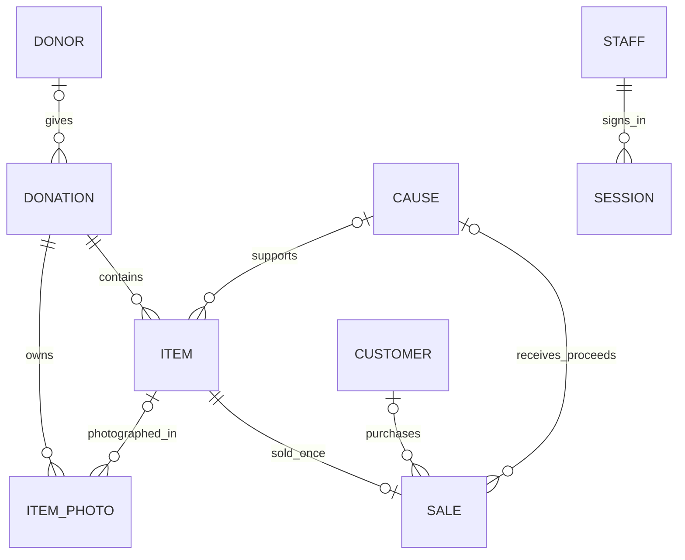

# Data and internet integration notes

## Data relationships

A donor has name, email, phone, nationality, contact preference and a validated list of favoured cause IDs. Anonymous donations have no donor ID. Each item's donor is obtained through its donation, never copied into the item's QR code. Every sale snapshots the selected cause ID, amount in minor units, currency and optional customer ID. One item can have at most one sale record. Activity events identify the relevant bag or item and staff actor.

Category-specific attributes are stored in a PostgreSQL JSON column and validated by the backend. `item_photos` stores image bytes (PostgreSQL BYTEA), media type, donation ID and optional item ID. Captures are first bound to the selected donation; saving the item attaches them to that item. Validation rejects photos from another bag or already bound to another item. Donor association follows `item_photos → donations → donors`; customer association, where a sale occurs, follows `items → sales → customers`. A customer is not substituted for the donor during sorting. Existing private file photos are imported on startup. Photo endpoints, label output, lookup and personal-data endpoints require a staff session.

## Existing Shopify preparation endpoint

`GET /api/items/{item_id}/shopify-export` returns an authenticated JSON draft for available resale items. The item drawer downloads it through **Shopify draft**. Fields include title, SKU/reference, brand, type, condition, material composition, cause, unit quantity and private photo filenames.

Only clothes, books, ornaments and jewellery are eligible for resale. The backend enforces that restriction on classification, sale recording, online-listing marking and export. The Android app accesses the same API over the PC's local address, using same-origin WebView session cookies; no database credentials are shipped to the phone.

The payload excludes donor/customer details. Private photo filenames are references for a future uploader; they are not publicly accessible Shopify image URLs. There is intentionally no live publishing side effect.

The market is local and **AED is the only currency**. Sale amounts are integer fils; new sale requests specifying another currency are rejected. The export declares AED, and the interface has no international currency selection.

## Next integration implementation

1. Configure a Shopify store domain, a server-side secret access token and a supported Admin GraphQL API version through environment variables. Never place a Shopify token in React, labels or source control.
2. Map the export to a draft product and one physical inventory unit. Use the local item's immutable reference as the SKU, with an additional local-ID metafield if needed. Keep the remote product/variant/inventory IDs locally so retries update the same product instead of creating duplicates.
3. Set a price and upload the three clothing photos with Shopify's staged media flow. Upload from the backend after staff authentication, without exposing donor records or making all uploaded files public.
4. Staff review the draft before publishing it. Keep the manual `listed_online` marker clearly separate from a confirmed remote publishing status.
5. Verify Shopify webhook signatures and record each webhook ID once. On a paid order, create the local sale with the Shopify order/line ID and the correct currency, then remove local availability. Do not depend on the manual listing marker for inventory control.
6. Handle the shop checkout competing with an online sale by reserving/locking the physical unit and synchronizing both sides. Add retries, reconciliation, webhook idempotency, cancellations and returns before turning live selling on.

The app server can remain local and initiate outbound HTTPS. Incoming Shopify webhooks need a public HTTPS gateway or another explicit synchronization strategy. The database port should remain private. The present prototype records local sales only and makes no live-shop synchronization claim.

## References used during implementation

- [FastAPI relational database documentation](https://fastapi.tiangolo.com/tutorial/sql-databases/)
- [SQLAlchemy version counters](https://docs.sqlalchemy.org/en/20/orm/versioning.html)
- [HTML5 QR scanner lifecycle](https://scanapp.org/html5-qrcode-docs/docs/intro)
- [Browser camera secure-context requirements](https://developer.mozilla.org/en-US/docs/Web/API/MediaDevices/getUserMedia)
