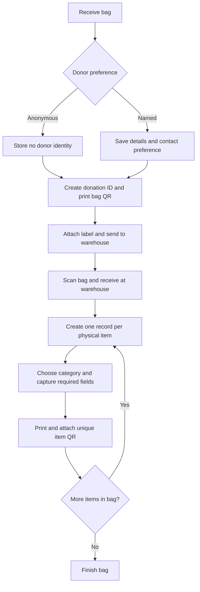
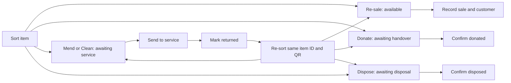

# Staff workflow and QR labels

## The two-label rule

**Bag QR:** identifies the intake donation. Attach this before dispatching the bag.

**Item QR:** identifies one sorted physical item. Every item belongs to its original bag. Never reuse a bag code for several independent stock items.

Both labels contain a stable URL such as `https://your-server/track/<uuid>`, plus a short readable reference (`BAG-…` or `ITM-…`). The URL contains no donor identity. Scanning opens the record after staff sign-in. Reprinting a label does not create a new bag or item.

## Intake and warehouse flow

Finishing a bag means all physical contents have been recorded. It does not mean every item has already been sold or processed. Staff are responsible for the physical count; the app prevents finishing a bag with no recorded items.

## Item routes

| Route | Required processor data | Next actions | Final stage |
| --- | --- | --- | --- |
| Re-sale / clothing | Item name, brand, exactly 3 photos, condition, material percentages totalling 100%, storage location, supporting cause; donor inherited from bag | Move location, mark online listing, record price/currency and optional customer | Sold |
| Re-sale / book | Title, author, condition, storage location, supporting cause; donor inherited from bag | Move location, mark online listing, record price/currency and optional customer | Sold |
| Re-sale / jewellery and ornaments | Item name, condition, location and cause; optional brand/maker and up to 3 photos; donor inherited from bag | Move location, mark online listing, record sale | Sold |
| Donate | Item type, recipient / place donated to | Confirm handover | Donated |
| Mend | Item type, workshop; optional repair note | Send to workshop → mark returned → re-sort | Determined by re-sort |
| Clean | Item type, laundry; optional care note | Send to laundry → mark returned → re-sort | Determined by re-sort |
| Dispose | Item type, appropriate disposal route | Confirm after physical disposal | Disposed |

Resale conditions: Excellent, Very good, Good and Fair. Donor details are inherited from the donation, so processors do not re-enter them. Donate intentionally keeps its form minimal.

All sale prices are in **AED**. The sale form has no international currency selection. In the Sorting Room and Inventory, **Active items** is the default view and hides sold, donated and disposed records. Tap **All items** to include them, **Sold items** to inspect sales, or choose a specific status in the dropdown. These controls only change what is displayed; original bag links, photos and activity histories remain available.

Clothes are the default item type for new records. Resale is limited to **clothes, books, ornaments and jewellery**. Toys, shoes, hats, homeware, bags and Other can follow Donate, Mend, Clean and Dispose, but cannot be sold or exported as resale. Clothing resale still requires three photos and composition totalling 100%; the other permitted resale types do not inherit clothing-only requirements. Existing unsold stock that no longer qualifies is marked for re-sorting without changing its QR or original donation link; historical sales are retained.

## Start with the physical bag

Tap **Bags to process**, **On the way**, **Being sorted**, or **Completed bags** at the top of the Sorting Room. Select the bag matching the label in front of you, then choose **Scan this bag**. The app checks that the scan matches the selected bag. Scanning a bag that is in transit receives it at the warehouse; choose **Sort an item** in its details to begin.

The selected bag and original donor stay visible above the item collection. The category counts and displayed items are scoped to that bag. Use **Sort next item** to continue without choosing the donor or bag again. **Change bag** switches lots; the close icon returns the collection to all bags. The item's original bag is locked during entry, and the backend prevents assigning a captured photo to another bag or item.

## Take pictures while sorting

Use **Take photos** in the item form. Allow camera access, frame the item and tap the shutter. Each shot saves automatically to PostgreSQL; keep the camera open for the next angle. Three shots complete clothing resale photography. Remove a thumbnail to retake it before saving the item.

The live camera requires HTTPS on tablets and iPads. **Device camera** requests the native rear camera on supported devices and saves the returned picture automatically. **Library** remains available separately. Photos are attached to the original bag immediately and to the item on Save. In **People → Donors**, tap a donor to view their bags and item photos. Anonymous bags remain unlinked to an identity.

Mending and cleaning do not create replacement items. The original QR stays attached during service and remains usable after re-sorting.

## A practical example

1. A donor gives one bag containing a shirt and a book. Intake creates one bag ID and QR.
2. Warehouse receives the bag and creates **two** item records.
3. The shirt is marked Clean and sent to a laundry with its own item QR. The book is classified Re-sale with its title, author, condition, shelf and cause.
4. The bag is marked complete because both contents are recorded.
5. The shirt returns. Staff scan its existing QR, mark returned, and re-sort it to Re-sale with 3 photos, brand, materials, condition, location and cause.
6. The shirt sells. Staff scan its code and record the amount and customer. Its record still links back to the original donor and donation; its timeline includes the cleaning trip.

## Printing and daily operation

- Print the bag label immediately after intake, or reprint it from the bag details.
- Print an item label after sorting. The current print template uses A4 sheets, dashed cut guides and approximately 36 mm QR codes. It is not aligned to a specific adhesive-sheet brand. Confirm printer scaling at 100%, scan a proof, and adjust the template before bulk printing.
- In Warehouse or Inventory, select item checkboxes and choose Labels to print a batch.
- Keep the blank margin around QR codes and attach them to a flat tag or smooth area. Avoid folds and tape glare over the symbol.
- Use your server's stable reachable address before printing. Retain the same hostname if the server moves.
- If scanning fails, enter the printed reference in Scan QR. If a label is damaged, locate the item and reprint; do not create a duplicate record.
- Update storage location whenever an item moves. Do not mark a donation or disposal complete until the physical handover is done.
- Keep the bag's donor preference. No contact means no contact, even if an email address is present.

Each successful transition stores a timestamp and the signed-in staff name. Edits use version checks: a stale action is rejected so staff do not accidentally overwrite another worker's changes.
