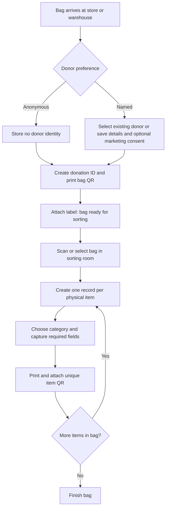
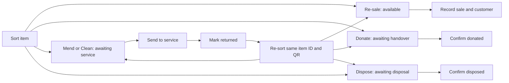

# Staff workflow and QR labels

## The two-label rule

**Bag QR:** identifies the intake donation. Record the bag when it arrives and attach its label before sorting.

**Item QR:** identifies one sorted physical item. Every item belongs to its original bag. Never reuse a bag code for several independent stock items.

Both labels contain a stable URL such as `https://your-server/track/<uuid>`, plus a short readable reference (`BAG-…` or `ITM-…`). The URL contains no donor identity. Scanning opens the record after staff sign-in. Reprinting a label does not create a new bag or item.

## Intake and warehouse flow

Finishing a bag means all physical contents have been recorded. It does not mean every item has already been sold or processed. Staff are responsible for the physical count; the app prevents finishing a bag with no recorded items.

## Item routes

| Route | Required processor data | Next actions | Final stage |
| --- | --- | --- | --- |
| Re-sale / clothing | Item name, brand, exactly 3 photos, condition, material percentages totalling 100%, storage location, supporting cause; donor inherited from bag | Move location, mark online listing, record price/currency and optional customer | Sold |
| Re-sale / book | Title, author, exactly 3 photos, condition, storage location, supporting cause; donor inherited from bag | Move location, mark online listing, record price/currency and optional customer | Sold |
| Re-sale / jewellery and ornaments | Item name, exactly 3 photos, condition, location and cause; optional brand/maker; donor inherited from bag | Move location, mark online listing, record sale | Sold |
| Donate | Optional photos (up to 3), item type, recipient / place donated to | Confirm handover | Donated |
| Mend | Optional photos (up to 3), item type, workshop; optional repair note | Send to workshop → mark returned → re-sort | Determined by re-sort |
| Clean | Optional photos (up to 3), item type, laundry; optional care note | Send to laundry → mark returned → re-sort | Determined by re-sort |
| Dispose | Optional photos (up to 3), item type, appropriate disposal route | Confirm after physical disposal | Disposed |

Resale conditions: Excellent, Very good, Good and Fair. Donor details are inherited from the donation, so processors do not re-enter them. Donate intentionally keeps its form minimal.

All sale prices are in **AED**. The sale form has no international currency selection. In the Sorting Room and Inventory, **Active items** is the default view and hides sold, donated and disposed records. Tap **All items** to include them, **Sold items** to inspect sales, or choose a specific status in the dropdown. These controls only change what is displayed; original bag links, photos and activity histories remain available.

Clothes are the default item type for new records. Resale is limited to **clothes, books, ornaments and jewellery**. Every resale type requires three different photos; clothing also requires a brand and material composition totalling 100%. Toys, shoes, hats, homeware, bags and Other can follow Donate, Mend, Clean and Dispose, but cannot be sold or exported as resale. Existing records are retained. Legacy resale records missing photos must be corrected before sale, online listing or Shopify export.

## Start with the physical bag

Tap **Bags to process**, **Being sorted**, or **Completed bags** at the top of the Sorting Room. **Items recorded** opens Inventory. Select the bag matching the label in front of you, then choose **Scan this bag**. The app checks that the scan matches the selected bag. New donations are ready for sorting immediately; choose **Sort an item** in the details to begin. The dispatch and on-the-way stages have been removed. Existing open bags are moved to sorting without changing IDs, item links or activity history.

The selected bag and original donor stay visible above the item collection. The category counts and displayed items are scoped to that bag. Use **Sort next item** to continue without choosing the donor or bag again. **Change bag** switches lots; the close icon returns the collection to all bags. The item's original bag is locked during entry, and the backend prevents assigning a captured photo to another bag or item.

## Take pictures while sorting

Use **Take photos** in the item form. Allow camera access, frame the item and tap the shutter. Each shot saves automatically to PostgreSQL; keep the camera open for the next angle. Three shots are required for every resale type; optional (up to three) for other routes. Remove a thumbnail to retake it before saving. To replace a saved picture, open **Edit item**, remove the old thumbnail, capture its replacement and save. The replacement stays linked to the original bag and item; previous photo ownership remains in the audit history.

The live camera requires HTTPS on tablets and iPads. **Device camera** requests the native rear camera on supported devices and saves the returned picture automatically. **Library** remains available separately. Photos are attached to the original bag immediately and to the item on Save. In **People → Donors**, tap a donor to view their bags and item photos. Anonymous bags remain unlinked to an identity.

Mending and cleaning do not create replacement items. The original QR stays attached during service and remains usable after re-sorting.

## A practical example

1. A donor gives one bag containing a shirt and a book. Intake creates one bag ID and QR.
2. The arrived bag is ready for sorting. Staff create **two** item records.
3. The shirt is marked Clean with optional photos (up to three) and sent to a laundry with its own item QR. The book is classified Re-sale with three photos, title, author, condition, shelf and cause.
4. The bag is marked complete because both contents are recorded.
5. The shirt returns. Staff scan its existing QR, mark returned, and re-sort it to Re-sale with 3 photos, brand, materials, condition, location and cause.
6. The shirt sells. Staff scan its code and record the amount and customer. Its record still links back to the original donor and donation; its timeline includes the cleaning trip.

## Printing and daily operation

- Print the bag label immediately after intake, or reprint it from the bag details.
- Print an item label after sorting. The preview centres the label; a single label also prints centrally on A4 paper. Each black-and-white label is 76 × 78 mm with a 42 mm QR code and dashed cut guides. Batch printing fits six labels on an A4 sheet. Print at actual size (100%) and scan a proof before bulk printing. This layout is shared by the browser, Android and iOS; it is not aligned to a specific adhesive-sheet brand.
- In Warehouse or Inventory, select item checkboxes and choose Labels to print a batch.
- Keep the blank margin around QR codes and attach them to a flat tag or smooth area. Avoid folds and tape glare over the symbol.
- Use your server's stable reachable address before printing. Retain the same hostname if the server moves.
- If scanning fails, enter the printed reference in Scan QR. If a label is damaged, locate the item and reprint; do not create a duplicate record.
- Update storage location whenever an item moves. Do not mark a donation or disposal complete until the physical handover is done.
- Keep the donor's preference. Marketing or updates require explicit consent and a matching email/phone contact detail. Contact details alone do not give permission. Anonymous donations have no donor identity or contact permission.

Each successful transition stores a timestamp and the signed-in staff name. Edits use version checks: a stale action is rejected so staff do not accidentally overwrite another worker's changes.

## Delete a dummy or mistaken inventory record

1. Open the item from Inventory or Warehouse and select **Delete item (admin)**.
2. Review its name and reference. If it has a recorded sale, that sale will also be removed and the totals will change.
3. Enter the reason, type the exact item reference, and enter the separate admin deletion password.
4. Tick the permanent-deletion confirmation, then select **Permanently delete item**.

Only a signed-in staff member who supplies the correct admin password can delete an item. The server checks it for every deletion; there is no persistent admin unlock. The password is masked and cleared after submission. Five incorrect attempts temporarily block further attempts for ten minutes.

Deletion removes the live inventory record, its attached database photos and any linked sale. The original bag, donor and other items remain. Audit snapshots retain the item and sale details, reason and staff identity, and the bag's activity records the deletion. The deleted QR no longer resolves. Deletion cannot be undone inside the app; use an approved database backup if recovery is required.

If the deletion action is absent, the administrator must configure it on the server using `scripts/Set-AdminDeletionPassword.ps1`. Do not put the admin password in printed guides, source code, screenshots or GitHub.

## Correct records and review donor impact

Use **Edit item** or **Edit bag** in a record's details, **Edit donor** / **Edit customer** in People, **Edit cause** in Causes and **Edit sale** in a sold item's details. IDs, QR labels, original donation links and workflow status stay the same. Correcting a sold item's cause also reallocates its recorded sale; correcting sale allocation updates the item too. Before/after snapshots and the staff actor are recorded. Record corrections retain the route; returned service items use **Re-sort this item** to choose a new route.

At intake, select an existing donor for repeat donations. Review their details and optional marketing checkbox, or create a new donor with consent unchecked. Consent covers Thrift for Good marketing, supported-cause updates and support rewards. It requires an email or phone contact method and can be withdrawn at intake or in **Edit donor**. Existing contacts are never automatically opted in. This prototype records permission but does not send messages.

**People → Impact dashboard** shows donations and recorded items per donor, nationality distribution, donors with contact details and consent, and anonymous donation counts. Filter by nationality, search donors or rank by donations/items, then open a donor to inspect their bags and photos. All item statuses count toward items donated. Anonymous bags count as donations, not identifiable individual people. The permission chart counts each bag once using the donor's current permission.

Use **People → Export People to Excel** to download all People records as an editable workbook, independent of active page filters. Donor rows include IDs/versions, contact information, nationality, marketing consent, preferred causes and donation/item totals. Separate tabs contain customer purchase totals and anonymous donation counts, plus an overview. Offline Excel edits are not imported into the database.
